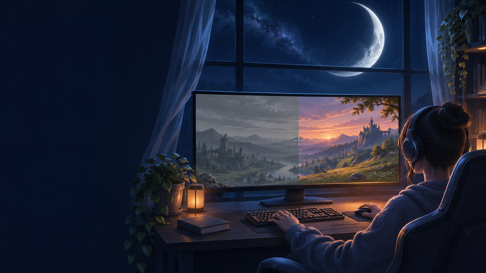

<p align="center">
  
</p>

<p align="center">
  <a href="https://github.com/realKarasu/luna/releases/latest"></a>
  
  <a href="LICENSE"></a>
</p>

<h3 align="center">Make your games easier to see, on every screen you own.</h3>

<p align="center">
  Luna brightens dark corners, makes colours pop, puts a crosshair in the middle of your screen<br>
  and gives you night vision at the press of a key. It runs on Windows, macOS and Linux.
</p>

---

## Free and open source, forever

Luna costs nothing today and will cost nothing tomorrow. There is no paid version, no subscription, no licence key, no account and no advert. It collects nothing about you: your settings stay on your computer. The whole source code is public under the [MIT licence](LICENSE), so anyone can read it, check it, build it and keep it alive.

## Download

Pick your system on the **[latest release page](https://github.com/realKarasu/luna/releases/latest)**:

| Your computer | File to download | |
| --- | --- | --- |
| **Windows 10 or 11** (64-bit) | `Luna_x.y.z_x64-setup.exe` | Recommended. An `.msi` is there too. |
| **macOS 10.15 or newer** (Apple silicon and Intel) | `Luna_x.y.z_universal.dmg` | One file for every Mac. |
| **Linux** (64-bit, X11) | `Luna_x.y.z_amd64.AppImage` | Runs on most distributions. |
| **Debian, Ubuntu, Mint, Pop!_OS** | `Luna_x.y.z_amd64.deb` | Installs like any other package. |

Once installed, Luna keeps itself up to date: new versions are downloaded and checked against the project's signature by the app itself. You can turn that off in Settings.

## What Luna does

- **See into the dark.** Raise gamma and brightness so enemies hiding in shadows stand out, without washing out the rest of the picture.
- **Make colours pop.** Turn up vibrance so players and items jump off the background. Luna finds your graphics card (NVIDIA, AMD, Intel) by itself and uses the best setting it has.
- **One setting per screen.** Each monitor gets its own look, saved for next time.
- **Presets in one click.** 27 ready-made looks, your own presets, and share codes to swap them with friends.
- **Crosshair overlay.** 10 designs, any colour and size, on top of any game, on the screen you choose.
- **Night vision and zoom.** Hold a key for a green or blue night vision look, or to magnify the middle of the screen.
- **Borderless window** (Windows). Takes the frame off a game in windowed mode, keeping its size or filling the screen, by key or by itself for the games you pick.
- **Game profiles** (Windows). Pick a gamma and colour preset, a crosshair, a resolution and refresh rate for each game, on one screen or several: Luna sets them when the game starts and puts everything back when it closes. Games installed by Steam, Epic and GOG are listed for you.
- **FPS counter and Potato Mode** (Windows). A small frame counter in a corner of the screen, with a frame time graph and the load of the PC if you want them, and one switch that gives the game everything a slow PC has.
- **Look wheel.** Hold a key, point at a preset, let go: the look changes instantly.
- **Optimizer** (Windows). Ten common gaming tweaks in one place, each one with an undo.
- **Clean** (Windows). Finds the caches, temporary files, old logs and crash reports that pile up on a PC and deletes the ones you tick.
- **Five styles.** Change the whole look of the app: Nebula, Observatoire, Calibration, Terrain or Studio.

Luna never opens, reads or changes a game's files or memory. It only uses the screen settings your system offers to every program, like night light tools do.

## Your first five minutes

1. **Install and open Luna.** It sits in the system tray (the menu bar on macOS) while it runs.
2. **Pick your screen** at the top of the Display page, then try a preset or move the Gamma slider. The preview shows the change before and after.
3. **Set your keys** on the Binds page: one for night vision, one for the look wheel, one to switch tuning on and off.
4. **Turn on the crosshair** if you want one, and choose its shape and colour.
5. **Done.** Quit Luna or press Reset at any time and your screens go back to exactly how they were.

## First launch, system by system

<details>
<summary><b>Windows</b>: "Windows protected your PC"</summary>

<br>

Luna is not signed with a paid certificate, so SmartScreen warns about it the first few times it is downloaded. This is not a virus alert. Click **More info**, then **Run anyway**. Luna installs for your user only and never asks for administrator rights.

</details>

<details>
<summary><b>macOS</b>: "Luna can't be opened" and the Accessibility permission</summary>

<br>

1. Open the `.dmg` and drag **Luna** into **Applications**.
2. The first time you open it, macOS stops it because it does not come from the App Store. Open **System Settings > Privacy & Security**, scroll down and click **Open Anyway** next to Luna, then confirm.
3. For your keys and mouse buttons to work in games, allow Luna in **System Settings > Privacy & Security > Accessibility**. Luna shows a reminder until this is on.

</details>

<details>
<summary><b>Linux</b>: AppImage, .deb and X11</summary>

<br>

- **AppImage**: make it executable, then run it.
  ```sh
  chmod +x Luna_*_amd64.AppImage
  ./Luna_*_amd64.AppImage
  ```
- **.deb**: `sudo apt install ./Luna_*_amd64.deb`, then open Luna from your app menu.
- Luna needs an **X11 session**. On GNOME or KDE with Wayland, pick the "on Xorg" session at the login screen. Under Wayland Luna still opens but shows a note, because Wayland does not let programs change screen colours or read keys.
- NVIDIA cards get the driver's digital vibrance through `nvidia-settings`, which comes with the NVIDIA driver.
- The crosshair needs a desktop with a compositor (the default on GNOME, KDE, Cinnamon and Xfce) to be see-through.

</details>

## What works where

| | Windows | macOS | Linux (X11) |
| --- | :---: | :---: | :---: |
| Gamma, brightness, contrast, red, green, blue | ✓ | ✓ | ✓ |
| Presets, share codes, before/after preview | ✓ | ✓ | ✓ |
| Night vision (green, blue) | ✓ | ✓ | ✓ |
| Crosshair overlay | ✓ | ✓ | ✓ |
| Binds and look wheel | ✓ | ✓ (Accessibility) | ✓ (keyboard, mouse 1 to 3) |
| Vibrance, NVIDIA | ✓ | | ✓ |
| Vibrance, AMD | ✓ | | |
| Hue, saturation, colour boost | ✓ | | |
| Sight colours (True Black, Red Black Holo) | ✓ | | |
| Ultra Zoom | ✓ | | |
| Borderless window | ✓ | | |
| Game profiles, FPS counter, Potato Mode | ✓ | | |
| Optimizer | ✓ | | |
| Clean | ✓ | | |
| Automatic updates | ✓ | ✓ | ✓ (AppImage) |

The empty boxes are not missing work: they rely on features that only Windows offers to ordinary programs, like the full-screen colour filter and the magnifier. Luna hides what your system cannot do instead of showing buttons that do nothing.

## Questions

**Is it safe to use in online games?**
The crosshair is a separate see-through window above the game, and colour changes use the same system settings as night light tools. Nothing is loaded into the game. Rules still differ between games and tournaments, so check the rules of the game you play before using it in ranked matches.

**How do I put everything back?**
Press Reset on the Display page, switch tuning off in the sidebar, or quit Luna. If Luna ever closes unexpectedly, your screens are put back the next time it starts.

**Where are my settings?**
In plain JSON files: `%APPDATA%\Luna` on Windows, `~/Library/Application Support/Luna` on macOS, `~/.config/luna` on Linux. The Settings page has a button that opens the folder.

**Does Luna connect to the internet?**
Only to check this repository for a new version, which you can turn off in Settings. Nothing about you or your computer is ever sent.

**I found a bug or have an idea.**
[Open an issue](https://github.com/realKarasu/luna/issues) with what you did, what you expected and your system. Luna sends no reports by itself, so an issue is the only way we hear about it.

## All the details

<details>
<summary>Full feature list</summary>

### Display tuning (per screen)
- **Tone**: gamma (0.60 to 3.00), brightness (-20 to +20), contrast (70 to 130 %) and red, green and blue gain (20 to 180 %), applied through the screen's gamma ramp. A live curve graph shows the result against a dashed identity line.
- **Colour** (Windows): hue (-180 to +180) and saturation (0 to 350 %) through the Windows colour effect, plus vibrance (0 to 250 %). Vibrance uses the driver's own setting where there is one: NVIDIA digital vibrance or AMD saturation, both loaded at run time with nothing to install. Whatever the driver cannot reach, and every screen on Intel or other cards, gets a matching saturation boost instead.
- **Vibrance on Linux**: NVIDIA digital vibrance through `nvidia-settings`.
- **Before/after preview** on reference pictures with a draggable split, using exactly the same math as the real output.
- Originals are saved at start and put back on quit, after a crash (a restore file is replayed on the next start) and from the Reset button. A master **Tuning on/off** switch.

### Presets
- 15 built-in gamma presets and 12 colour presets as cards with live thumbnails.
- Save your own, rename, delete, and **Restore defaults** to bring deleted built-ins back.
- **Share codes** (`LUNA-G-...`, `LUNA-C-...`, `LUNA-X-...`) with a checksum, so a mistyped code is caught.

### Game tools
- **Ultra Zoom** (Windows): hold a key or mouse button to magnify the middle of a chosen screen (1.5x to 8x).
- **Rust profile**: **Green NVG** and **Blue NVG** (gamma 3.00 with a tint while a bind is held), plus **Green True Black** and **Red Black Holo** on Windows, a colour matrix that pushes a sight's colour toward black.
- **Borderless** (Windows): pick an open window and click Make borderless, or press your key in game. By default the game keeps its size and place; it can also fill the screen, sit centred at 16:9, 21:9 or 4:3, or take a custom size. Remember a game and Luna does it by itself each time it opens.
- **Game profiles** (Windows): add a game from the ones Steam, Epic and GOG installed, from the open programs, or by its program name. A profile can also set the mode of your other screens, for graphics cards that only offer a screen's best mode when another screen runs slower: the other screens change first and everything goes back in reverse. While it runs, Luna applies its gamma preset, colour preset, crosshair (hidden, shown, or a saved slot), screen resolution and refresh rate, Potato Mode and Borderless. Everything goes back when it closes, when Luna quits, and at the next start after a crash. Profiles start about two seconds after the game.
- **FPS counter** (Windows): frames per second, frame time and 1% low of the game in front, in the corner and on the screen you choose. A frame time graph and a block of PC details (processor and graphics card load, card temperature, video memory and memory in use) can be added under it. Frames are read from Windows' own events, from the game for Direct3D 9 to 12 and from the display for Vulkan and OpenGL, so counting needs Luna to run as administrator; the PC details do not. It cannot show over exclusive full screen, and processor temperature is not read.
- **Potato Mode** (Windows): the game in front gets high priority, other programs in your session slow down with Windows' efficiency mode, and the power plan, Game Mode, background recording, transparency and animations switches go on if they were off. Voice chat, streaming, music and system programs are left alone. By switch, by key, or per game profile, and undone when it stops.
- **Binds**: keyboard keys or mouse buttons for Zoom, Borderless, FPS counter, Potato Mode, NVG, Tuning on/off, four colour keys and the look wheel. Click a key box and press the key to record it.
- **Look wheel**: hold F7 (changeable), point with the mouse at one of up to 8 presets, release to apply.

### Crosshair overlay
- Transparent, click-through, always on top, on the screen you choose.
- 10 designs, 8 colours (or any colour), sliders for ring, arm length, gap, thickness, centre dot, outline and opacity.
- 8 save slots, share codes, and an optional global **Ctrl + Alt + Shift + F11** toggle (off by default).

### Optimizer (Windows)
- **Optimize all** and **Undo all**, plus 10 switches: High performance power plan, Game Mode, background recording off, optimizations for windowed games, mouse acceleration off, Sticky Keys popup off, notifications off, background apps off, transparency effects off and window animations off.
- Every switch reads the current state and backs it up before changing anything, so Undo restores exactly what you had. Only per-user settings are changed.

### Clean (Windows)
- One scan measures what can go, grouped as Windows, Browsers, Apps and games, and Developer tools, with the size of each item.
- **Windows**: temporary files older than a day, crash dumps and error reports, Windows Update downloads, old Windows logs, the thumbnail cache and the Recycle Bin.
- **Browsers**: page and picture caches of Chrome, Edge, Brave, Vivaldi, Opera, Opera GX, Arc and Firefox, for every profile. History, passwords and cookies stay.
- **Apps and games**: Discord, Steam, Epic Games Launcher, Battle.net, Spotify, Teams and Slack caches, and the NVIDIA, AMD and Intel shader caches.
- **Developer tools**: npm, Yarn, pip, NuGet, Cargo and Go download caches.
- The safe items are ticked by default; the Recycle Bin, shader caches, thumbnails and package caches are left for you to choose. Files a program holds open are skipped, and Luna says which program is open.
- Items that belong to Windows need administrator: **Restart as administrator** reopens Luna on the Clean page after Windows asks for permission.
- Luna never follows links or junctions out of a folder, and never touches documents, downloads or game saves.

### Styles and settings
- Five styles that change the whole look of the app, each with its own fonts and one detail of its own: **Nebula** (animated night sky, or your own picture or GIF), **Observatoire** (graphite night, tick marks under every slider), **Calibration** (light measuring lab, grey step wedge under the preview), **Terrain** (phosphor green, sight brackets, segmented sliders) and **Studio** (dense grading suite with a live histogram).
- Accent colour for every style.
- Start with your computer, start minimized to the tray, close to tray, and a tray icon with quick toggles.

### Updates
- Luna checks this repository's latest release a few seconds after it starts, then every 6 hours.
- A new version is downloaded and its signature is checked against the public key built into the app, so only files signed by the project are accepted.
- Found at start: it installs right away and Luna opens again. Found later: it waits and installs when Luna quits, or at once from **Restart to update**, so a game is never cut off.
- **Automatic updates** can be turned off in Settings; **Check now** still works.

</details>

<details>
<summary>How it works, system by system</summary>

| Part | Windows | macOS | Linux |
| --- | --- | --- | --- |
| Tone and NVG | `SetDeviceGammaRamp` | `CGSetDisplayTransferByTable` | XRandR CRTC gamma |
| Hue, saturation, sight colours | `MagSetFullscreenColorEffect` | | |
| GPU per screen | DXGI adapters and outputs | | `/sys/class/drm` |
| Vibrance, NVIDIA | NVAPI, from `nvapi64.dll` | | `nvidia-settings` |
| Vibrance, AMD | ADL saturation, from `atiadlxx.dll` | | |
| Ultra Zoom | `MagSetFullscreenTransform` | | |
| Borderless window | `SetWindowLongPtrW`, `SetWindowPos` | | |
| Binds and look wheel | Low-level keyboard and mouse hooks | Polling, needs Accessibility | Polling the X server |
| Start with the computer | `Run` registry key | LaunchAgent | XDG autostart entry |
| Optimizer | Per-user registry, `powercfg`, `SystemParametersInfo` | | |
| Clean | File system, `SHQueryRecycleBinW`, `SHEmptyRecycleBinW` | | |
| Updates | NSIS installer | `.app` bundle | AppImage |

Windows limits how far a gamma ramp may move from neutral for programs without administrator rights. When a curve is refused, Luna applies the strongest version Windows accepts and tells you how much of it is active. macOS and Linux have no such limit.

</details>

## Build it yourself

You need [Node.js](https://nodejs.org/) 18 or newer and the [Rust toolchain](https://rustup.rs/).

<details>
<summary>Extra packages per system</summary>

- **Windows**: the MSVC build tools and WebView2 (already part of Windows 11).
- **macOS**: the Xcode command line tools (`xcode-select --install`).
- **Debian or Ubuntu**:
  ```sh
  sudo apt install libwebkit2gtk-4.1-dev libayatana-appindicator3-dev librsvg2-dev \
    libxdo-dev libssl-dev libx11-dev libxrandr-dev patchelf file pkg-config build-essential
  ```

</details>

```sh
npm install
npm run tauri build
```

The packages end up in `src-tauri/target/release/bundle/`. Other useful commands:

```sh
npm run tauri dev                 # run in development mode
npm run build                     # type-check and build the interface only
cd src-tauri && cargo test        # unit tests
```

Opening `dist/index.html` from a plain web server shows the interface in a browser preview mode with a demo backend: nothing on your computer is changed.

<details>
<summary>Publishing a release (maintainers)</summary>

```sh
npm run release -- 0.4.0 "What changed, in one or two lines"
```

The script bumps the version, builds and signs the Windows installers, pushes the tag, waits for GitHub Actions to build the macOS and Linux packages, signs those too, writes `latest.json` and creates the GitHub release that every installed copy reads. It needs the [GitHub CLI](https://cli.github.com/) signed in and the updater private key at `%USERPROFILE%\.tauri\luna-updater.key` (or in `TAURI_SIGNING_PRIVATE_KEY`). That key never goes in the repository or in GitHub: every signature is made on the maintainer's machine.

</details>

## Contributing

Bug reports, ideas, translations and pull requests are all welcome. If you are new to open source, an issue describing what you saw is already a real help. Testing on a Mac or a Linux machine with an unusual setup is especially useful.

> Luna is an independent project. It is not affiliated with, endorsed by or connected to any other display tuning product or company.

## Licence

[MIT](LICENSE). Free to use, change and share, forever.

The system logos on the banner come from [Font Awesome Free](https://fontawesome.com) (CC BY 4.0).
